## Status
Approved

## Last Updated
2026-11-13

## Overview
This document describes the **additive architectural changes** required to implement Todo App v2 (TODO-002). The base architecture defined in `architecture.md` (Status: Approved) is entirely preserved — no existing endpoints, classes, or data structures are removed or renamed. Three sets of enhancements are layered on top: (1) a `priority` field on the `Todo` model with server-side validation and normalization; (2) entirely client-side filter tabs and live text search; and (3) CSS/JS UI polish including fade-in animation, hover styles, reduced opacity for completed rows, an empty-state element, and an Add button spinner. No new Maven dependencies and no new REST endpoints are introduced.

---

## Scope Boundary

| Layer | Base (architecture.md) | v2 additions |
|---|---|---|
| REST endpoints | 4 endpoints unchanged | None added |
| Backend classes | `Todo`, `TodoService`, `TodoController`, `TodoApplication` | `Todo` and `TodoService` modified; `TodoController` minimal change |
| Frontend | `index.html` (single file) | Same file extended with priority UI, filter bar, search input, animations |
| Maven dependencies | `spring-boot-starter-web`, `spring-boot-starter-test` | None added |
| Storage | `CopyOnWriteArrayList<Todo>` in-memory | Same; `Todo` objects now carry `priority` field |
| Branch | `master` (base) | `feature/todo-app-v2` (branches from `master`) |

---

## Component Diagram

```mermaid
graph TD
    Browser["Browser\n(index.html + inline JS)\n\nNEW: priority <select>\nNEW: filter bar + search input\nNEW: priority badge render\nNEW: allTodos[] client cache\nNEW: fade-in CSS / button spinner"]

    subgraph SpringBoot["Spring Boot 3.x Process (port 8080) — UNCHANGED"]
        StaticHandler["Static Resource Handler\n(Spring MVC)"]
        Controller["TodoController\n(@RestController /api/todos)\n\nMINOR: reads body.get('priority')"]
        Service["TodoService\n(@Service)\n\nCHANGED: add(text, priority)\nwith normalise + validate"]
        Store["In-Memory Store\nCopyOnWriteArrayList<Todo>\nAtomicLong\n\nTodo now has priority field"]
    end

    Browser -- "GET /" --> StaticHandler
    StaticHandler -- "serves index.html" --> Browser
    Browser -- "GET /api/todos" --> Controller
    Browser -- "POST /api/todos\n{text, priority}" --> Controller
    Browser -- "PUT /api/todos/{id}" --> Controller
    Browser -- "DELETE /api/todos/{id}" --> Controller
    Controller -- "delegates" --> Service
    Service -- "reads/writes" --> Store
    Controller -- "JSON (now includes priority)" --> Browser
```



### Client-side filter/search data flow (no server round-trips)

```
GET /api/todos
      │
      ▼
  allTodos[] ──────────────────────────────────────┐
  (module-level array,                              │
   refreshed on every server                        │
   response: load, add, toggle, delete)             │
                                                    │
  activeFilter  ──────────► filterAndRender()       │
  ("all"|"active"|"completed")     │                │
                                   │                │
  searchText ─────────────────────►│                │
  (from #search-input)             │                │
                                   ▼                │
                             visibleTodos[]  ────────┘
                             (derived, never stored)
                                   │
                                   ▼
                        renderTodos(visibleTodos)
                        updateCounter(visibleTodos)
```

---

## Components

### Todo.java — CHANGED
- **Responsibility:** Carries the four fields exposed in the REST API: `id`, `text`, `done`, and the new `priority`. Jackson auto-serializes/deserializes `priority` as part of the existing `ObjectMapper` pipeline — no configuration change needed.
- **Technology:** Same plain mutable POJO; Java stdlib only.
- **Interfaces (additive changes only):**
  - New field: `String priority` (private)
  - New constructor overload: `Todo(Long id, String text, boolean done, String priority)`
  - Existing no-arg constructor retained (required for Jackson deserialization)
  - Existing 3-arg constructor retained for backward compatibility with existing tests
  - New getter: `String getPriority()`
  - New setter: `void setPriority(String priority)`
- **Notes:** The `priority` field is set only by `TodoService.add()`; it is never updated after creation (out of scope per requirements constraint).

### TodoService.java — CHANGED
- **Responsibility:** Owns the in-memory store. The `add()` method is extended to accept a `priority` argument, normalize it to uppercase, validate it against the allowed set, and default to `"MEDIUM"` when null or blank. All other methods (`getAll`, `toggle`, `delete`) are unchanged.
- **Technology:** Same `@Service` bean; Java stdlib only (`String.toUpperCase()`, `Set.of()`).
- **Interfaces (additive changes):**
  - `add(String text)` — **overload retained**, delegates to `add(text, null)` so all existing `TodoServiceTest` call-sites compile unchanged
  - `add(String text, String priority)` — new two-arg form; called by `TodoController`
  - Normalization: `priority = (priority == null || priority.isBlank()) ? "MEDIUM" : priority.trim().toUpperCase()`
  - Validation: if normalized value is not in `Set.of("HIGH", "MEDIUM", "LOW")`, throw `IllegalArgumentException("Invalid priority: must be HIGH, MEDIUM, or LOW")`
  - On success: `new Todo(counter.incrementAndGet(), text.trim(), false, normalizedPriority)`
  - `getAll()`, `toggle(Long id)`, `delete(Long id)` — unchanged
- **Notes:** The existing blank/length checks on `text` are retained before the priority logic runs. The one-arg overload is the backward-compat shim; the controller always calls the two-arg form.

### TodoController.java — MINIMAL CHANGE
- **Responsibility:** HTTP adapter layer. The POST handler is updated to extract `priority` from the request body map and forward it to the updated `TodoService.add()`. All other handlers are unchanged.
- **Technology:** Same `@RestController`; `Map<String, String>` request body approach is retained (no new DTO class needed — `body.get("priority")` reads the optional field; if absent, `Map.get` returns `null`, which the service normalizes to `"MEDIUM"`).
- **Interfaces (additive change to POST only):**

  Before:
  ```java
  Todo created = todoService.add(body.get("text"));
  ```
  After:
  ```java
  Todo created = todoService.add(body.get("text"), body.get("priority"));
  ```

  - All four endpoint signatures are unchanged (`GET`, `POST`, `PUT`, `DELETE`)
  - Error handling block for `IllegalArgumentException` already present — it catches the new priority-invalid exception automatically with no code change

### static/index.html — CHANGED (frontend only)
- **Responsibility:** Extended with priority UI, filter bar, search input, animations, and button spinner. The `allTodos` module-level array is introduced as the client-side cache. `filterAndRender()` replaces direct `renderTodos()` calls for all state-changing operations.
- **Technology:** Same plain HTML5, CSS3, vanilla JS (ES6+). No external libraries.
- **New HTML elements:**

  | Element | Location in DOM | Purpose |
  |---|---|---|
  | `<select id="priority-select">` | Inside `#add-form`, after `#task-input` | Priority dropdown (High/Medium/Low, default Medium) |
  | `<div id="filter-bar">` | Between `#add-form` and `#todo-list` | Contains filter tab buttons and search input |
  | `<button class="filter-tab" data-filter="all">` | Inside `#filter-bar` | "All" tab |
  | `<button class="filter-tab" data-filter="active">` | Inside `#filter-bar` | "Active" tab |
  | `<button class="filter-tab" data-filter="completed">` | Inside `#filter-bar` | "Completed" tab |
  | `<input id="search-input" type="text">` | Inside `#filter-bar` | Live text search field |
  | `<span class="priority-badge badge-{high|medium|low}">` | Inside each `<li>`, before delete button | Colour-coded priority label |
  | `<div id="empty-state">` | Replaces existing `<p id="empty-msg">` | Styled empty-state element (no tasks on server) |
  | `<p id="no-match-msg">` | Sibling of `#todo-list` | "No matching tasks" message when filter/search yields zero results but tasks exist |

- **New/changed CSS rules:**

  | Rule | Purpose |
  |---|---|
  | `@keyframes fadeIn` + `.todo-row-new { animation: fadeIn 0.4s ease; }` | Fade-in targeted to newly added rows only — class added by JS on insertion, **not** applied globally to `.todo-row` (FR-22, NFR-07, Design Decision 9) |
  | `#todo-list li:hover { background: #f7fafc; }` | Hover highlight (FR-23) |
  | `.done { opacity: 0.5; }` (applied to `<li>`) | Muted row for completed items (FR-24) — supplements existing `.done .todo-text` strike-through |
  | `.priority-badge { ... }` base badge styles | Shared badge shape/font |
  | `.badge-high { background: #fed7d7; color: #c53030; }` | Red-toned High badge (FR-16) |
  | `.badge-medium { background: #fefcbf; color: #b7791f; }` | Yellow-toned Medium badge (FR-16) |
  | `.badge-low { background: #c6f6d5; color: #276749; }` | Green-toned Low badge (FR-16) |
  | `.filter-tab.active { ... }` | Visual active-state indicator for selected tab |
  | `#add-form button:disabled { opacity: 0.6; cursor: not-allowed; }` | Disabled state styling for Add button (FR-26) |
  | Mobile media query update | Ensure `#priority-select` and `#filter-bar` wrap on small viewports (NFR-10) |

- **New/changed JS logic:**

  | Function / variable | Description |
  |---|---|
  | `let allTodos = []` | Module-level cache; holds the last full server response |
  | `let activeFilter = 'all'` | Module-level state; `'all'` \| `'active'` \| `'completed'` |
  | `function filterAndRender()` | Applies active filter and search text to `allTodos`, then calls `renderTodos(visibleTodos)` and `updateCounter(visibleTodos)`. **Three-state visibility logic (Design Decision 10):** (1) if `allTodos.length === 0` → show `#empty-state`, hide `#no-match-msg`, hide `#todo-list`; (2) else if `visibleTodos.length === 0` → show `#no-match-msg`, hide `#empty-state`, hide `#todo-list`; (3) else → show `#todo-list`, hide both messages. |
  | `function renderTodos(todos)` | Modified to render `priority` badge per item; uses CSS class lookup `badgeClass(priority)` to avoid inserting raw server strings into innerHTML |
  | `function updateCounter(todos)` | Modified to operate on the passed `visibleTodos` array (not necessarily the full set) |
  | `loadTodos()` | Sets `allTodos = todos`, then calls `filterAndRender()` instead of `renderTodos()` |
  | `addTodo(text, priority)` | Extended to include `priority` in the POST body; on success, resets `activeFilter = 'all'` and clears `#search-input` before calling `loadTodos()` (FR-21); disables Add button before fetch, re-enables in `finally` block (FR-26) |
  | `#add-form submit` handler | Reads `priority-select.value`; passes both `text` and `priority` to `addTodo()` |
  | `#filter-bar` click delegation | Sets `activeFilter`, updates `.active` class on tabs, calls `filterAndRender()` (no server call) |
  | `#search-input` input event | Calls `filterAndRender()` on every keystroke (no server call) |
  | `badgeClass(priority)` | Maps `"HIGH"` → `"badge-high"`, etc.; provides CSS class string only — raw priority string from server is never injected into innerHTML (SC-06, SC-07) |
  | Badge text display | Use `document.createTextNode()` or `span.textContent = labelFor(priority)` with a whitelist map (`{HIGH: "High", MEDIUM: "Medium", LOW: "Low"}`); never `innerHTML` |

### TodoApplication.java — UNCHANGED
- No changes required.

---

## Data Flow

### Priority: form → server → badge

```
index.html (browser)                 TodoController          TodoService
────────────────────                 ─────────────           ───────────
<select id="priority-select">
User picks "HIGH"
        │
        ▼
addTodo("Buy milk", "HIGH")
        │
        ▼
fetch POST /api/todos
  body: { "text": "Buy milk",
          "priority": "HIGH" }
        │                       ──────────────►  create(@RequestBody Map body)
        │                                            │
        │                                        body.get("text")  → "Buy milk"
        │                                        body.get("priority") → "HIGH"
        │                                            │
        │                                            ▼
        │                                        todoService.add("Buy milk", "HIGH")
        │                                            │
        │                                        normalize: "HIGH".toUpperCase() = "HIGH"
        │                                        validate: HIGH ∈ {HIGH,MEDIUM,LOW} ✓
        │                                            │
        │                                        new Todo(1L, "Buy milk", false, "HIGH")
        │                                        todos.add(todo)
        │                                        return todo
        │                                            │
        │                       ◄──────────────  ResponseEntity 201
        │                          { "id": 1,
        │                            "text": "Buy milk",
        │                            "done": false,
        │                            "priority": "HIGH" }
        │
        ▼
  allTodos updated via loadTodos()
  filterAndRender()
  renderTodos(visibleTodos)
        │
        ▼
  <li>
    <input type="checkbox">
    <span class="todo-text">Buy milk</span>
    <span class="priority-badge badge-high">High</span>
    <button class="delete-btn">Delete</button>
  </li>
  (fade-in animation applied via CSS @keyframes)
```

### Priority omitted (default MEDIUM)

```
POST body: { "text": "Buy milk" }
                │
                ▼
  body.get("priority") → null
                │
                ▼
  TodoService.add("Buy milk", null)
  normalise: null → "MEDIUM"
  validate: "MEDIUM" ∈ {HIGH,MEDIUM,LOW} ✓
                │
                ▼
  Response: { ..., "priority": "MEDIUM" }
```

### Priority invalid (HTTP 400)

```
POST body: { "text": "Task", "priority": "URGENT" }
                │
                ▼
  TodoService.add("Task", "URGENT")
  normalise: "URGENT".toUpperCase() = "URGENT"
  validate: "URGENT" ∉ {HIGH,MEDIUM,LOW} → throw IllegalArgumentException
                │
                ▼
  TodoController catch(IllegalArgumentException e)
  → ResponseEntity.badRequest()
      .body(Map.of("error", "Invalid priority: must be HIGH, MEDIUM, or LOW"))
  → HTTP 400 { "error": "..." }
                │
                ▼
  Frontend: showError(data.error)
  Add button re-enabled (finally block)
```

### Filter and search (client-side only, no server call)

```
allTodos = [ {id:1, text:"Buy milk",   done:false, priority:"HIGH"},
             {id:2, text:"Walk dog",   done:true,  priority:"LOW"},
             {id:3, text:"Buy coffee", done:false, priority:"MEDIUM"} ]

User clicks "Active" tab:
  activeFilter = "active"
  filterAndRender()
    → visibleTodos = allTodos.filter(t => !t.done)
                   = [{id:1,...}, {id:3,...}]
    → renderTodos(visibleTodos)   // 2 rows rendered
    → updateCounter(visibleTodos) // "0 of 2 done"

User then types "buy" in search:
  searchText = "buy"
  filterAndRender()
    → pass1 (filter): allTodos.filter(t => !t.done) = [{id:1},{id:3}]
    → pass2 (search): .filter(t => t.text.toLowerCase().includes("buy"))
                    = [{id:1, "Buy milk"}, {id:3, "Buy coffee"}]
    → visibleTodos = [{id:1},{id:3}]   (both match "buy", case-insensitive)
    → updateCounter: "0 of 2 done"

User then changes search to "milk":
  filterAndRender()
    → visibleTodos = [{id:1, "Buy milk"}]
    → updateCounter: "0 of 1 done"
```

---

## Data Models

### Todo.java — updated

| Field | Java type | JSON type | v2 change |
|---|---|---|---|
| `id` | `Long` | `number` | Unchanged |
| `text` | `String` | `string` | Unchanged |
| `done` | `boolean` | `boolean` | Unchanged |
| `priority` | `String` | `string` | **NEW** — values `"HIGH"`, `"MEDIUM"`, `"LOW"`; never null after creation |

### Updated request / response shapes

**POST /api/todos — request body (v2)**
```json
{ "text": "Buy groceries", "priority": "HIGH" }
```
Priority field is optional; omitted → server defaults to `"MEDIUM"`.

**POST /api/todos — 201 response / GET list item (v2)**
```json
{ "id": 1, "text": "Buy groceries", "done": false, "priority": "HIGH" }
```

**GET /api/todos — 200 response (v2)**
```json
[
  { "id": 1, "text": "Buy groceries", "done": false, "priority": "HIGH" },
  { "id": 2, "text": "Walk dog",      "done": true,  "priority": "LOW"  }
]
```

All existing response shapes for `PUT` and `DELETE` are unchanged. The `PUT` response body will now also include `priority` automatically (Jackson serializes all fields), but the toggle operation itself does not modify priority.

**Error response body — priority invalid (new)**
```json
{ "error": "Invalid priority: must be HIGH, MEDIUM, or LOW" }
```

### Updated API contract

| Method | Path | Request Body | Response Body | Status Codes |
|---|---|---|---|---|
| `GET` | `/api/todos` | — | `[ {id, text, done, priority} ]` | 200 |
| `POST` | `/api/todos` | `{ "text": "...", "priority": "..." }` | `{ id, text, done, priority }` | 201, 400 |
| `PUT` | `/api/todos/{id}` | — | `{ id, text, done, priority }` | 200, 404 |
| `DELETE` | `/api/todos/{id}` | — | — | 204, 404 |

The `priority` field in the POST body is optional. `PUT` does not accept or modify priority (out of scope).

---

## Technology Stack

The v2 stack is identical to the base stack. No new entries are added.

| Concern | Choice | Justification |
|---|---|---|
| Priority validation | `Set.of("HIGH","MEDIUM","LOW")` in `TodoService` | Java stdlib; no library required; O(1) lookup |
| Priority normalization | `String.trim().toUpperCase()` | Java stdlib; zero allocation path for already-upper strings |
| Client-side filter | `Array.prototype.filter` | Native ES6+; NFR-08 (no extra HTTP requests) |
| Client-side search | `String.prototype.includes` with `.toLowerCase()` | Native ES6+; case-insensitive per FR-18 |
| CSS animations | `@keyframes` + `animation` property | CSS3 native; NFR-07 (no JS animation) |
| CSS hover | `:hover` pseudo-class | CSS3 native; FR-23 (no JS required) |

---

## External Dependencies

No new dependencies are introduced. The existing two Maven dependencies are sufficient:

| Dependency | Purpose |
|---|---|
| `spring-boot-starter-web` | Jackson auto-serializes the new `priority` field with no configuration change; no new annotation needed |
| `spring-boot-starter-test` | JUnit 5 and MockMvc cover the new priority validation and controller tests |

---

## Error Handling Strategy

The base error-handling table from `architecture.md` is extended with one new row (marked **NEW**). All existing rows are unchanged.

| Boundary | Failure mode | Handling |
|---|---|---|
| `POST /api/todos` — blank text | `IllegalArgumentException` from service | 400 Bad Request `{"error": "Task text cannot be empty."}` |
| `POST /api/todos` — text > 500 chars | `IllegalArgumentException` from service | 400 Bad Request `{"error": "Task text must be 500 characters or fewer."}` |
| `POST /api/todos` — invalid priority value | `IllegalArgumentException` from service | **NEW** 400 Bad Request `{"error": "Invalid priority: must be HIGH, MEDIUM, or LOW"}` |
| `PUT /api/todos/{id}` — unknown id | `NoSuchElementException` from service | 404 Not Found |
| `DELETE /api/todos/{id}` — unknown id | `NoSuchElementException` from service | 404 Not Found |
| Frontend — 400 response | Server returns error JSON | `showError(data.error)` near banner; Add button re-enabled via `finally` |
| Frontend — 404 response | Item no longer exists | `loadTodos()` refresh; `allTodos` updated; `filterAndRender()` re-applies current filter |
| Frontend — network error | Fetch promise rejects | Error banner; button re-enabled via `finally` |
| Filter/search — zero visible results | All tasks hidden by filter+search, but tasks exist on server | `#no-match-msg` shown; `#empty-state` hidden; counter shows "0 of 0 done" |
| EC-12 — Add button double-click | Second click arrives while first POST is in flight | Button disabled after first click (FR-26); second click has no effect; single POST sent |

---

## Test Plan

### New unit tests — TodoServiceTest.java (additions)

| Test method | Scenario | Expected |
|---|---|---|
| `add_withHighPriority_returnsTodoWithHighPriority` | `add("task", "HIGH")` | returned `Todo.getPriority()` equals `"HIGH"` |
| `add_withLowercasePriority_normalizesToUppercase` | `add("task", "low")` | priority stored as `"LOW"` |
| `add_withMixedCasePriority_normalizesToUppercase` | `add("task", "Medium")` | priority stored as `"MEDIUM"` |
| `add_withNullPriority_defaultsToMedium` | `add("task", null)` | priority equals `"MEDIUM"` |
| `add_withBlankPriority_defaultsToMedium` | `add("task", "  ")` | priority equals `"MEDIUM"` |
| `add_withInvalidPriority_throwsIllegalArgumentException` | `add("task", "URGENT")` | throws `IllegalArgumentException` |
| `getAll_returnsTasksWithPriorityField` | Add two tasks with different priorities; call `getAll()` | both returned todos have non-null, valid priority values |
| `add_withLowPriority_returnsTodoWithLowPriority` | `add("task", "LOW")` | priority equals `"LOW"` |

### New controller tests — TodoControllerTest.java (additions)

| Test method | Scenario | Expected |
|---|---|---|
| `createTodo_withExplicitHighPriority_returns201WithPriority` | POST `{"text":"task","priority":"HIGH"}` | 201; response body contains `"priority":"HIGH"` |
| `createTodo_withoutPriority_defaultsToMedium` | POST `{"text":"task"}` | 201; response body contains `"priority":"MEDIUM"` |
| `createTodo_withNullPriority_defaultsToMedium` | POST `{"text":"task","priority":null}` | 201; response body contains `"priority":"MEDIUM"` |
| `createTodo_withInvalidPriority_returns400` | POST `{"text":"task","priority":"URGENT"}` | 400; response body contains `"error"` key |
| `createTodo_withLowercasePriority_normalizesAndReturns201` | POST `{"text":"task","priority":"high"}` | 201; response body contains `"priority":"HIGH"` |
| `getAllTodos_includesPriorityField` | Add task then GET | each object in array has `"priority"` key |
| `toggleTodo_doesNotChangePriority` | Add HIGH-priority task, PUT to toggle, GET | priority still `"HIGH"` after toggle |

---

## Architectural Constraints

All seven constraints from `architecture.md` remain in force without modification. The following additional constraints apply to v2:

8. **No new REST endpoints** — filter, search, and counter updates are purely client-side. Adding a server-side filter endpoint would violate NFR-08 and requires a design review.
9. **Priority is immutable after creation** — `PUT /api/todos/{id}` must not accept or modify `priority`. Any extension of the toggle/update endpoint to accept a desired-state body or priority change requires a design review.
10. **Priority badge uses CSS class lookup, not raw string injection** — the server-returned priority string must be mapped to a CSS class and a display label via a whitelist map before touching the DOM. Injecting the raw string via `innerHTML` or as an attribute without sanitisation is prohibited (SC-06).
11. **Filter and search state live only in JS module-level variables** — `activeFilter` and `searchText` are never persisted to `localStorage`, cookies, or the URL. Adding URL-based filter state requires a design review.
12. **`allTodos` is replaced wholesale on every server response** — there is no partial/incremental update of the client cache. This keeps the client/server state contract simple and avoids stale-state bugs.

---

## Open Questions

1. **Exact empty-state illustration** — FR-25 requires a "visually distinct" empty-state element but does not mandate an SVG illustration vs. a large emoji vs. styled text. The implementation stage should choose; the architecture imposes no constraint beyond "visually distinct from the no-match message".
2. **Counter label wording when filter is active** — **Locked (Design Decision 6):** Counter always shows `"X of Y done"` where X/Y reflect the visible (filtered) set. No `"(filtered)"` suffix. This matches the original AC-01 format and avoids UI clutter.
3. ~~**requirements-v2.md Status**~~ — Resolved: requirements-v2.md advanced to Approved by human on 2026-11-13.

### New test to add (Design Decision fix — whitespace normalisation)
Add to `TodoServiceTest.java`:

| Test method | Scenario | Expected |
|---|---|---|
| `add_withWhitespacePaddedPriority_normalizesCorrectly` | `add("task", "  HIGH  ")` | priority stored as `"HIGH"` (trim before toUpperCase) |
