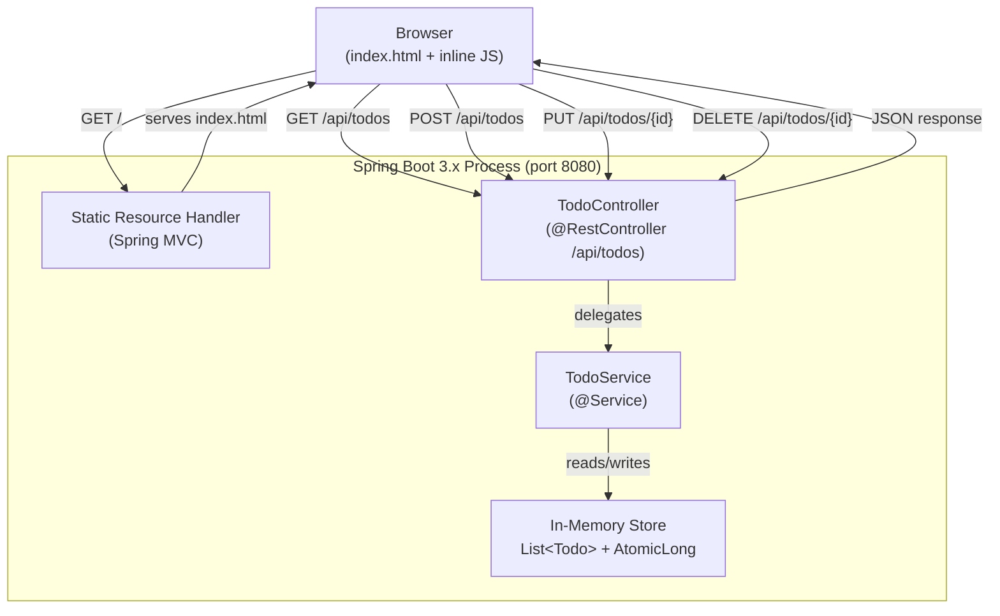

## Status
Approved

## Last Updated
2026-10-22

## Overview
This system is a single-page Todo List web application built with Java 17 and Spring Boot 3.x. The backend exposes a four-endpoint REST API backed by an in-memory `List<Todo>` (no database), while the frontend is a single static HTML file served by the same Spring Boot process that uses the browser Fetch API to interact with those endpoints without full page reloads. The key design principle is maximum simplicity: one deployable JAR, zero external dependencies beyond `spring-boot-starter-web`, and no frontend build pipeline.

---

## Architecture Diagram



---

## Components

### Todo.java
- **Responsibility:** Plain data model representing a single todo item. Carries the three fields exposed in the REST API (`id`, `text`, `done`). Jackson serializes instances to/from JSON automatically via Spring Boot's default `ObjectMapper`.
- **Technology:** Plain mutable POJO class with private fields and public getters/setters. Java records are excluded because their immutability conflicts with the in-place `done` toggle required by FR-04. No external library required.
- **Interfaces:**
  - Fields: `Long id`, `String text`, `boolean done`
  - Full-argument constructor used by `TodoService`; getters/setters used by `TodoService.toggle()` and Jackson serialization.
  - Constructed by `TodoService`; read by `TodoController` for serialization.

### TodoService.java
- **Responsibility:** Owns the in-memory todo store. Provides the four business operations (list all, add, toggle, delete). Manages unique ID generation with an `AtomicLong`. Uses `CopyOnWriteArrayList` to guard against concurrent-access issues without requiring explicit iteration locking (assumption A-2).
- **Technology:** Plain Spring `@Service` bean; Java stdlib `java.util.concurrent.atomic.AtomicLong`; `java.util.concurrent.CopyOnWriteArrayList` (chosen over `Collections.synchronizedList` because it is iterator-safe without explicit caller locking, appropriate for this read-heavy, low-write workload).
- **Interfaces:**
  - `List<Todo> getAll()` — returns snapshot of all todos.
  - `Todo add(String text)` — validates text is not blank and not longer than 500 characters (throws `IllegalArgumentException` otherwise), creates and stores a new `Todo`, returns it.
  - `Todo toggle(Long id)` — flips `done` on the identified item using `todo.setDone(!todo.isDone())`; throws `NoSuchElementException` if not found.
  - `void delete(Long id)` — removes the identified item; throws `NoSuchElementException` if not found.

### TodoController.java
- **Responsibility:** HTTP adapter layer. Maps the four REST endpoints to `TodoService` methods. Translates service exceptions to appropriate HTTP status codes (`400`, `404`). Returns JSON via Spring MVC's `@ResponseBody` / Jackson.
- **Technology:** Spring MVC `@RestController`; `@RequestMapping`, `@GetMapping`, `@PostMapping`, `@PutMapping`, `@DeleteMapping`; `ResponseEntity<T>`.
- **Interfaces:**
  - `GET  /api/todos`        → `200 OK`, body: `List<Todo>`
  - `POST /api/todos`        → `201 Created`, body: `Todo`; `400 Bad Request` on blank text
  - `PUT  /api/todos/{id}`   → `200 OK`, body: updated `Todo`; `404 Not Found` on unknown id
  - `DELETE /api/todos/{id}` → `204 No Content`; `404 Not Found` on unknown id

### static/index.html
- **Responsibility:** Single-page frontend. Renders the todo input form, task list (`<ul>`), and "X of Y done" counter. Wires DOM events to Fetch API calls. Applies CSS strike-through to completed items. Validates input client-side before sending POST.
- **Technology:** Plain HTML5, CSS3, vanilla JavaScript (ES6+, Fetch API). No external scripts, no bundler.
- **Interfaces:**
  - Sends requests to `/api/todos` (relative URL — same origin as Spring Boot).
  - Reads responses and updates the DOM directly (text nodes, not `innerHTML`, to prevent XSS — SC-01).

### TodoApplication.java
- **Responsibility:** Spring Boot entry point. `@SpringBootApplication` class with `main` method that calls `SpringApplication.run`.
- **Technology:** `spring-boot-starter-web` auto-configuration.
- **Interfaces:** None beyond the standard Spring Boot lifecycle.

---

## Data Flow

1. **Initial page load** — Browser GETs `http://localhost:8080/`; Spring Boot's static resource handler returns `index.html`. The page's `DOMContentLoaded` handler fires `GET /api/todos`; the controller calls `TodoService.getAll()`, serializes the (initially empty) list to JSON, and returns `200 OK []`. The JS renders the empty list and updates the counter to "0 of 0 done".

2. **Add a todo** — User types text and clicks Add. JS validates the field is not blank; if blank, shows a validation message and stops. Otherwise, JS calls `POST /api/todos` with body `{"text":"<value>"}`. Controller calls `TodoService.add(text)`, which assigns the next `AtomicLong` ID, sets `done=false`, appends to the list, and returns the new `Todo`. Controller returns `201 Created` with the todo JSON. JS appends a new `<li>` to the list and updates the counter.

3. **Toggle done** — User clicks the Done checkbox on an item. JS calls `PUT /api/todos/{id}`. Controller calls `TodoService.toggle(id)`, which flips `done` and returns the updated item. Controller returns `200 OK`. JS updates the checkbox state, applies or removes the `text-decoration: line-through` CSS, and refreshes the counter.

4. **Delete a todo** — User clicks Delete on an item. JS calls `DELETE /api/todos/{id}`. Controller calls `TodoService.delete(id)`. Controller returns `204 No Content`. JS removes the `<li>` from the DOM and updates the counter.

5. **Error paths** — On `404` (item already deleted, concurrent access), the JS silently refreshes the full list via `GET /api/todos` and re-renders. On `400`, the JS displays the server's error message near the input field.

---

## Data Models

### Todo (server-side class + JSON representation)

| Field | Java type | JSON type | Notes |
|-------|-----------|-----------|-------|
| `id`   | `Long`    | `number`  | Auto-incremented, 1-based, never reused within a session |
| `text` | `String`  | `string`  | Non-blank, max 500 characters; validated by `TodoService.add()` — returns HTTP 400 if exceeded |
| `done` | `boolean` | `boolean` | `false` on creation; toggled by PUT |

### Request / Response shapes

**POST /api/todos — request body**
```json
{ "text": "Buy groceries" }
```

**POST /api/todos — 201 response / GET list item**
```json
{ "id": 1, "text": "Buy groceries", "done": false }
```

**PUT /api/todos/{id} — no request body; 200 response**
```json
{ "id": 1, "text": "Buy groceries", "done": true }
```

**DELETE /api/todos/{id} — no request body; 204 response (empty body)**

**Error response body (400 / 404)**
```json
{ "error": "Text must not be blank" }
```

---

## API Contract

| Method   | Path               | Request Body          | Response Body        | Status Codes          |
|----------|--------------------|-----------------------|----------------------|-----------------------|
| `GET`    | `/api/todos`       | —                     | `[ {id, text, done} ]` | 200                 |
| `POST`   | `/api/todos`       | `{ "text": "..." }`   | `{ id, text, done }` | 201, 400              |
| `PUT`    | `/api/todos/{id}`  | —                     | `{ id, text, done }` | 200, 404              |
| `DELETE` | `/api/todos/{id}`  | —                     | —                    | 204, 404              |

---

## Technology Stack

| Concern | Choice | Justification |
|---------|--------|---------------|
| Language | Java 17 | LTS release; mandated by requirements constraint |
| Framework | Spring Boot 3.x (`spring-boot-starter-web`) | Provides embedded Tomcat, Spring MVC, Jackson; single dependency satisfies all server-side needs (FR-01 – FR-07) |
| Build tool | Maven (`pom.xml`) | Mandated by requirements constraint; `mvn spring-boot:run` startup |
| JSON serialization | Jackson (bundled with `spring-boot-starter-web`) | No additional dependency; automatic via `@RestController` |
| In-memory store | `java.util.concurrent.CopyOnWriteArrayList` + `java.util.concurrent.atomic.AtomicLong` | Java stdlib; thread-safe without explicit iteration locking; sufficient for single-user dev use (FR-06) |
| Frontend | Vanilla HTML5 / CSS3 / ES6+ JS | Mandated by requirements constraint; no build pipeline (NFR-06) |
| HTTP client (browser) | Fetch API | Native browser API; no library required (FR-10) |
| Test framework | JUnit 5 (bundled via `spring-boot-starter-test`) | Stdlib-adjacent; standard Spring Boot test dependency |

---

## External Dependencies

| Dependency | Maven coordinates | Purpose |
|------------|-------------------|---------|
| Spring Boot Starter Web | `org.springframework.boot:spring-boot-starter-web` | Embedded Tomcat, Spring MVC REST support, Jackson JSON |
| Spring Boot Starter Test | `org.springframework.boot:spring-boot-starter-test` (scope: test) | JUnit 5, Mockito for `TodoServiceTest` |

No other third-party dependencies are required or permitted (NFR-06, SC-05).

---

## File Structure

```
src/
├── main/
│   ├── java/com/example/todo/
│   │   ├── TodoApplication.java
│   │   ├── Todo.java
│   │   ├── TodoService.java
│   │   └── TodoController.java
│   └── resources/
│       └── static/
│           └── index.html
└── test/
    └── java/com/example/todo/
        ├── TodoServiceTest.java
        └── TodoControllerTest.java
pom.xml
```

---

## Error Handling Strategy

| Boundary | Failure mode | Handling |
|----------|-------------|---------|
| `POST /api/todos` — blank text | `IllegalArgumentException` from `TodoService.add` | Controller catches and returns `400 Bad Request` with `{"error": "..."}` |
| `PUT /api/todos/{id}` — unknown id | `NoSuchElementException` from `TodoService.toggle` | Controller catches and returns `404 Not Found` |
| `DELETE /api/todos/{id}` — unknown id | `NoSuchElementException` from `TodoService.delete` | Controller catches and returns `404 Not Found` |
| Frontend — 400 response | Server returns error JSON | JS displays message near input; no list re-render needed |
| Frontend — 404 response | Item no longer exists | JS silently refreshes the full list via `GET /api/todos` |
| Frontend — network error | Fetch promise rejects | JS catches and displays an error banner with text "Network error — please try again" above the task list; banner auto-dismisses after 5 seconds or when the next successful response arrives; list state preserved |
| Server restart during session | Next request hits empty server | Frontend reflects server state on next successful fetch |

All exception-to-HTTP mappings are handled at the controller layer using `try/catch` blocks on service calls, keeping `TodoService` free of HTTP concerns.

---

## Architectural Constraints

These decisions must not be changed during implementation without a design review:

1. **Single deployable unit** — the backend and frontend are deployed as one Spring Boot application. There is no separate static file server.
2. **No database** — all persistence is in the `List<Todo>` field of `TodoService`. Introducing any persistence layer (JPA, H2, file I/O) violates FR-06 and requires re-approval.
3. **No frontend framework or build step** — `index.html` must remain a single file with inline CSS and JS, served from `src/main/resources/static/`. No npm, no bundler.
4. **ID generation via `AtomicLong`** — IDs are never reused within a session. The counter resets only on server restart (by design, per FR-06 / assumption A-3).
5. **No CORS configuration** — the frontend is same-origin; adding `@CrossOrigin` or a CORS filter would require a security re-review (SC-04).
6. **No authentication layer** — adding any auth mechanism is explicitly out of scope and would require re-approval.
7. **PUT /api/todos/{id} is intentionally non-idempotent** — the endpoint always toggles (flips) `done`, meaning two successive identical PUT requests return different states. This is a deliberate design choice per FR-04 and assumption A-4. Any future change to accept a desired-state body (e.g. `{"done": true}`) and restore REST idempotency requires a design review.

---

## Open Questions

All open questions were resolved during Stage 3 Design Review (2026-10-22):

1. **Max text length** — Resolved: 500-character maximum enforced server-side in `TodoService.add()` with HTTP 400 response; HTML `maxlength="500"` added to frontend input element.
2. **requirements.md Status field** — Resolved: `requirements.md` updated to `Approved` status as part of Stage 3.
